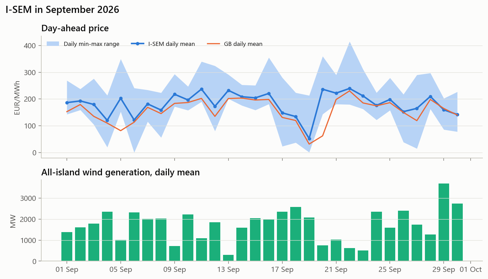

# I-SEM monthly market note - September 2026

*Day-ahead market (DAM). For commercial and finance colleagues. Data to 30 September 2026.*

## Headlines

- **Prices rose again.** The DAM averaged **183 EUR/MWh**, +7% on
  August and +94% on September 2025. It was the
  highest month in our two-year dataset.
- **More wind did not lower the level.** Wind penetration doubled to 35%
  (August: 18%), yet prices rose, in step with GB
  (156 EUR/MWh, +5%). The level is being set by gas, not by wind.
- **Spreads widened sharply.** The median daily max-min spread was **149 EUR/MWh**
  (August: 89). Wind swung between calm and windy days, which is
  good for flexible assets.

## What happened

| | September 2026 | August 2026 | September 2025 |
|---|---|---|---|
| Mean DAM price (EUR/MWh) | 182.7 | 171.0 | 94.3 |
| GB day-ahead mean (EUR/MWh) | 156.2 | 149.4 | 76.8 |
| Weekday evening peak, 17:00-20:00 (EUR/MWh) | 235.8 | 206.6 | 144.2 |
| Median daily spread (EUR/MWh) | 149 | 89 | 114 |
| All-island wind, mean (MW) | 1,707 | 836 | 1,541 |
| ROI wind penetration | 35% | 18% | 34% |
| ROI load, mean (MW) | 3,959 | 3,779 | 3,749 |
| Hours at or below 5 EUR/MWh | 13 | 0 | 29 |

- **Calm days set the highs.** The highest hourly price, 415 EUR/MWh, came on
  22 September, when wind averaged only 613 MW. On 4 calm days
  (11, 13, 20, 22 September; wind below 1,100 MW) the daily mean was above 230 EUR/MWh.
- **Windy days with a weak GB market set the lows.** On 19 September the daily mean fell to
  52 EUR/MWh: wind was 2,067 MW and GB averaged only
  32. That day accounted for 10 of the month's 13 hours at or below
  5 EUR/MWh. There were 0 negative hours.
- **Demand is rising into autumn.** ROI load averaged 3,959 MW, +5% on
  August, with darker evenings lifting the weekday peak to 236 EUR/MWh.

## What it means for our assets

**Wind.** The wind-weighted (capture) price was **166 EUR/MWh**, a capture rate of
**91%** of the baseload average (August: 96%). Revenue per MWh
was high in absolute terms, but the discount to baseload widened. When the whole fleet is
generating, the price falls (the cannibalisation effect). The capture rate is structurally lower
in windy months, and averaged 85% over the test year.

**Battery (1 MW / 2 MWh, DAM arbitrage only).** This was the **#2 month of the test year**
for the forecast-driven strategy, at **EUR 5.3k per MW**. Perfect foresight
would have earned EUR 6.7k, and a fixed charge/discharge schedule only
EUR 2.0k. The fixed rule failed because the daily price shape moved away from
last year's pattern.

**Forecasting.** This was our day-ahead price model's worst month (MAE 46 EUR/MWh,
against 25 for the year). Most of the error was the *level*: the
model lagged the gas-driven rise. The *shape* stayed right, which is what the battery needs, so
battery revenue held up. Adding a gas-price input is the top model improvement.

## Watch list for October

- **Gas and GB prices.** They have driven the I-SEM monthly mean up for 3 consecutive months.
- **Autumn wind.** Expect wider spreads and a lower wind capture rate.
- **Load.** Rising load into winter will make low-wind evenings expensive. A calm, cold spell
  like December 2024's would mean spike risk.

*Source: our analysis of Ember/SEMOpx DAM prices, Energy-Charts (ENTSO-E) wind and load, and
Open-Meteo forecasts. DAM only. Battery figures exclude system services, capacity and balancing
revenue. The full methodology is in the project README.*
