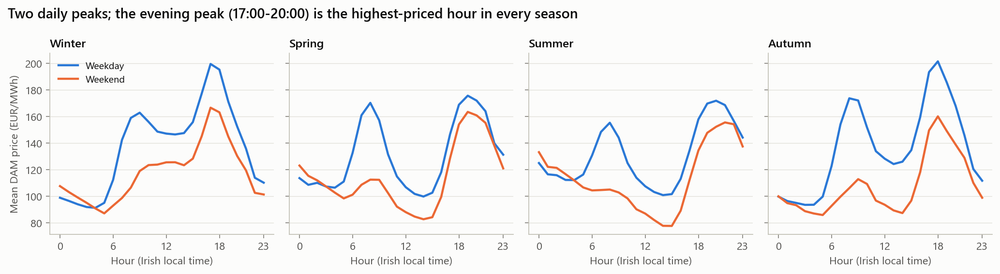
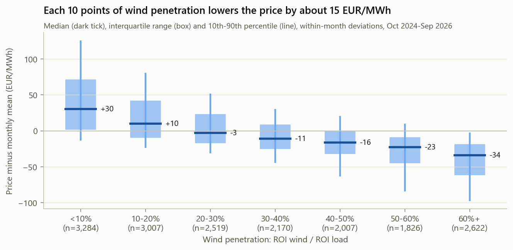
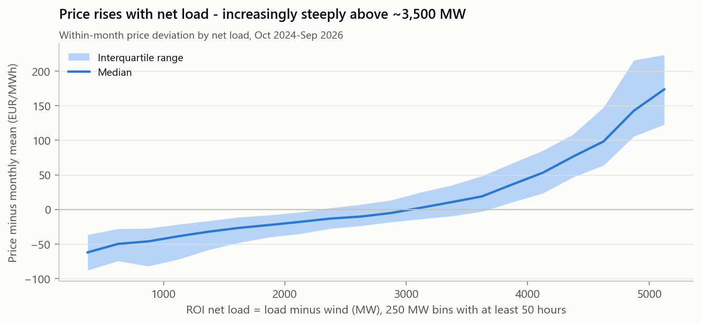
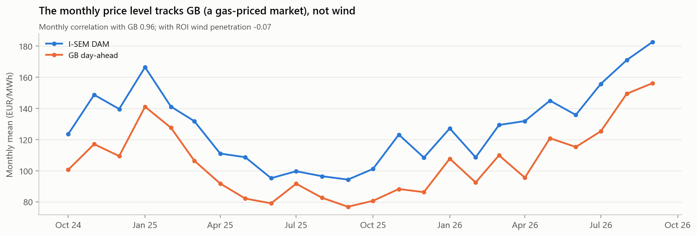
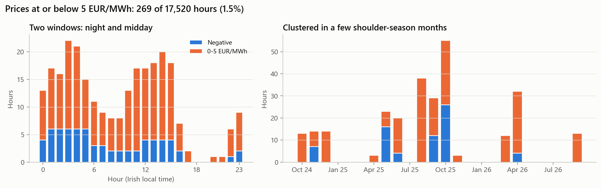
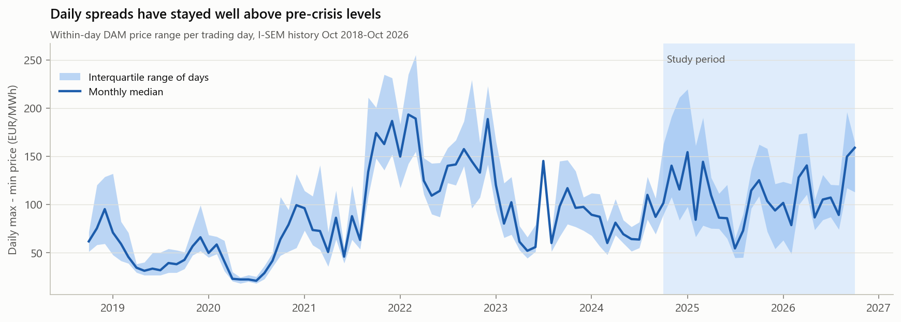
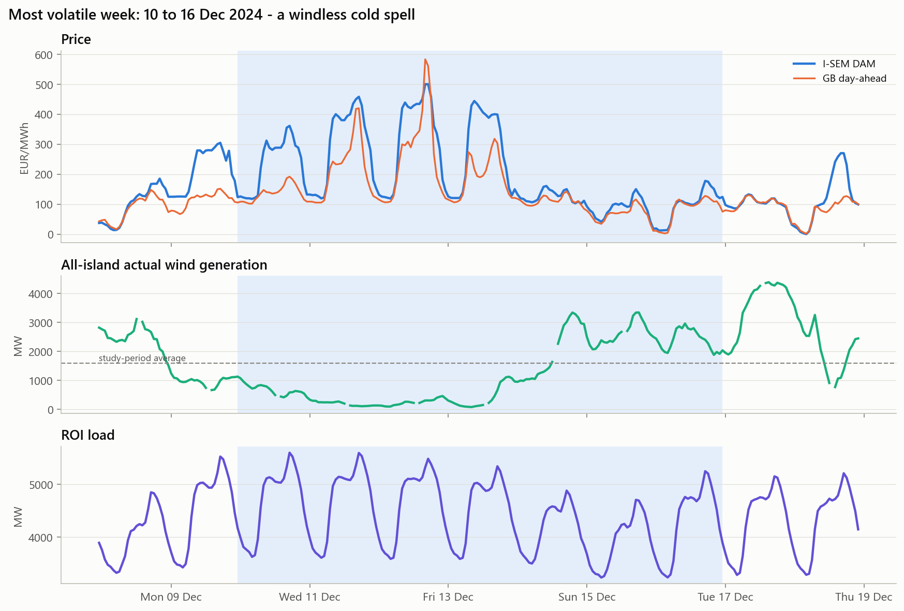

# Phase 2 - I-SEM day-ahead market analysis

Study period: trading days 2024-10-01 to 2026-09-30 (17,520 hours). Mean DAM price
128.2 EUR/MWh (Year 1 121.1, Year 2 135.1). All numbers come from
`src/phase2_analysis.py`; the metrics are in `reports/phase2_metrics.json`.
Wind penetration = ROI wind / ROI load (DECISIONS.md D8).

> **Data note.** These results use the corrected price series. Ember's Ireland prices are
> labelled 24 hours late. Before the correction, the merit-order effect looked about three
> times weaker than it really is. See DECISIONS.md D9.

## 1. Price shape by hour, day type and season

- **Two daily peaks on weekdays.** Prices peak in the morning (07:00-09:00) and again in the evening. The
  evening peak is the most expensive hour of the day in every season: 201 EUR/MWh
  at 18:00 in autumn and 199 at 17:00 in winter
  (weekday means).
- **Where the low point falls.** In autumn and winter the cheapest hours are overnight
  (about 03:00-04:00). In spring and summer they move to **14:00**.
- **Weekends.** Weekends are on average 20.8 EUR/MWh cheaper than weekdays, and
  they have almost no morning peak. Without commuting and office demand, only the evening peak remains.

*Why:* the evening peak is when household demand stacks on top of commercial demand, and solar
output is zero. The most expensive gas and peaking units are then at the margin. The
**midday low in spring and summer is consistent with fast-growing solar output**. Our data
contain no solar series, so this is an interpretation we have not tested.

## 2. Merit-order effect: wind penetration vs price

- **Price falls as wind penetration rises.** Each extra 10 percentage points lowers the price
  by **14.7 EUR/MWh** after removing month-level effects
  (95% CI 14.4 to 15.0). Adding
  hour-of-day effects barely changes this: 14.0.
- **The effect is large.** Within a month, the median price is +30 EUR/MWh
  relative to the monthly mean when wind penetration is below 10%, and
  -34 EUR/MWh when it is above 60%.
- **Wind alone explains 27% of hourly price variation.** Month dummies alone
  explain 18%.

- **Net load (load minus wind) is the better single explanatory variable.** Its correlation
  with the within-month price deviation is 0.69, against
  -0.56 for wind penetration.
- **The relationship is convex.** The median price deviation runs from -62 EUR/MWh at
  about 400 MW of net load to +19 at 3,600 MW and +174 at 5,100 MW.

*Why:* this is the supply curve, or merit order. Wind has near-zero marginal cost and
displaces thermal plant. As net load rises, the price is set by progressively more
expensive units: efficient CCGTs, then older gas and oil units, then peakers. That is why
the last few hundred MW of net load move the price far more than the first.

- **The monthly price level follows GB, not wind.** Monthly correlation with GB is
  0.96; with wind penetration it is -0.07. The level
  also climbs through Year 2, from 94 EUR/MWh in 2025-09 to
  183 in 2026-09.

*Why:* gas sets the marginal price in most hours in both markets, so the fuel price fixes the
level. Wind decides where within that level a given hour sits. For forecasting (Phase 3), the
level has to come from recent prices, because we have no gas-price data.

## 3. Negative and near-zero prices

- **Low prices are rare.** 269 hours (1.5%) are at or below
  5 EUR/MWh, and only 69 are negative (minimum -23.5 EUR/MWh).
- **They cluster in two windows:** night, 00:00-06:00 (43% of low hours),
  and midday, 10:00-15:00 (38%). They are concentrated in a few
  shoulder-season months, led by 2025-10, 2025-08, 2026-04.
- **Even very high wind rarely pushes prices to zero.** With wind penetration of 60% or more,
  only 5.9% of hours price at or below 5 EUR/MWh. When the I-SEM price is
  that low, the GB price averages -1.6 EUR/MWh, so the two markets are usually
  cheap together.

*Why:* zero or negative prices need surplus renewable output that cannot be exported or
stored, at times of low demand. In I-SEM, surplus wind can usually still be exported to GB,
which supports the price. The system also limits instantaneous non-synchronous generation and
requires a minimum number of conventional units online. Wind beyond those limits is
**dispatched down** by the system operator, which does not show up in the DAM price as a
crash. Prices collapse only when GB is also oversupplied. Midday low-price hours point again
to solar adding to the surplus.

## 4. Daily price spreads

- **Spreads are wide.** In the study period the median daily max-minus-min spread is
  **104 EUR/MWh**, and 53% of days exceed
  100 EUR/MWh. The 10th to 90th percentile range is 54 to 197.
- **What a 2-hour battery can capture.** The average of the 2 most expensive hours minus the
  2 cheapest has a median of 97 EUR/MWh.
- **Spreads widened in Year 2.** The median rose from 100 to
  108. Spreads scale with the price level (correlation
  0.42).
- **Spreads are still well above pre-crisis levels.** The 2019 median was
  43 EUR/MWh; 2025 was 97.
  Days with an Ember flat-price artefact are excluded (D9).

*Why:* spreads are the gap between night or midday prices, when wind and solar are setting
low prices, and evening prices, when gas peakers set high ones. Higher gas prices raise the
evening price more than the night price, so the spread widens in euro terms. This is the
revenue pool for Phase 4.

## 5. Event study: 2024-12-10 to 2024-12-16

This was the most volatile week in the study period (std of hourly price
132 EUR/MWh, range 488).

- **2024-12-10 to 2024-12-13: a calm, cold spell.** All-island wind
  averaged only 203-700 MW, against a study-period average of
  1585. Forecast temperatures were 1-3 degC and
  ROI load was about 4,634 MW. Daily mean prices reached 312 EUR/MWh,
  peaking at 500. GB was stressed at the same time (daily mean up to
  257), so imports offered little relief.
- **When the wind returned,** at 1,864-2,616 MW from
  2024-12-14, daily mean prices fell to 89-127 EUR/MWh
  within two days.

*Why:* this is the merit order working in both directions in a single week. A windless high-
pressure system over north-west Europe pushed I-SEM onto its most expensive thermal units
while GB was short as well. For a battery, these are the days that pay: spreads of 300+
EUR/MWh.
