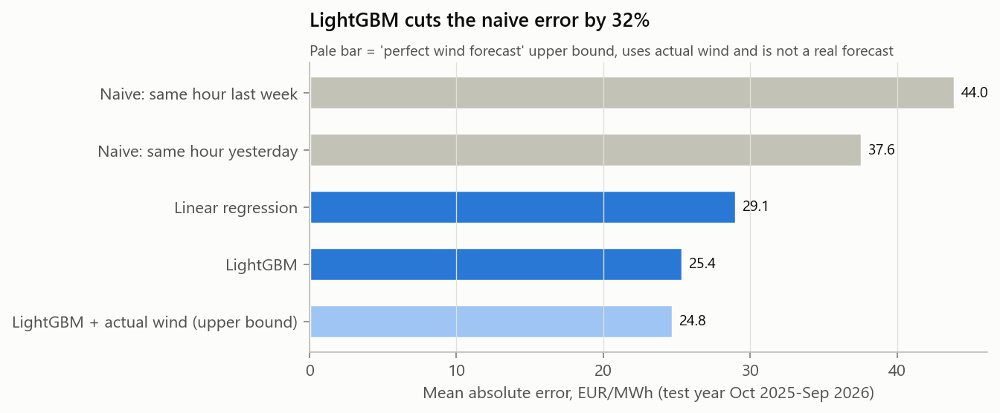
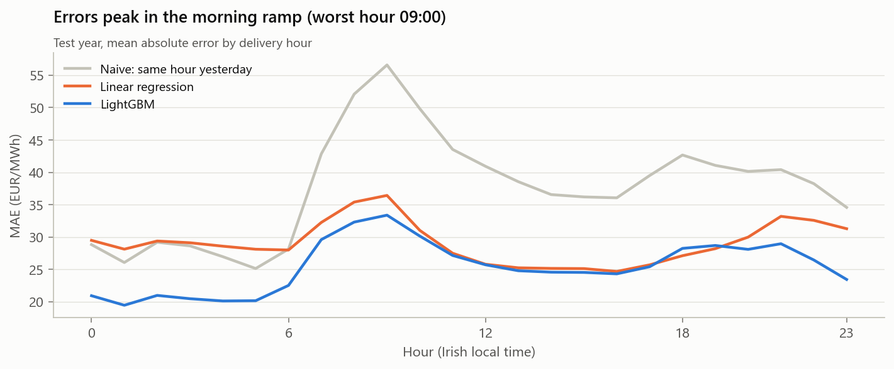
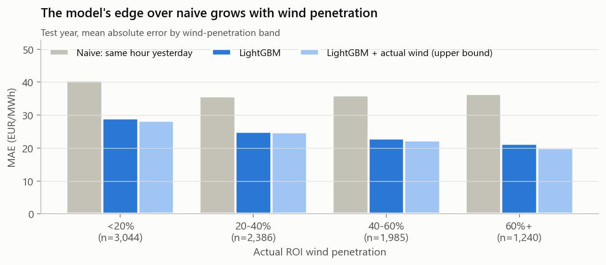
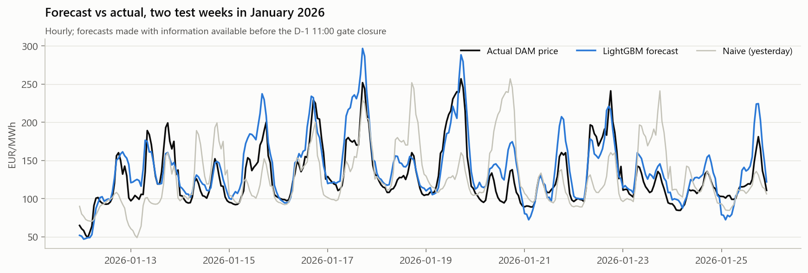
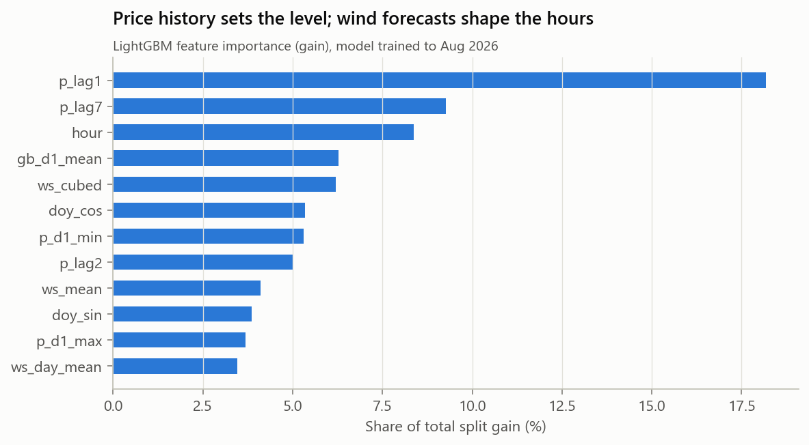

# Phase 3 - Day-ahead price forecasting

**Target:** the hourly DAM price for every hour of trading day D.
**Test year:** trading days 2025-10-01 to 2026-09-30. 8,685 hours are scored
in which every model has a forecast and the actual price exists.
Code: `src/phase3_forecast.py`; metrics: `reports/phase3_metrics.json`.

## The no-leakage rule

The DAM for day D closes at **11:00 Irish time on D-1**, so a forecast may only use what was
known at that moment:

| Allowed | Why it is known at 11:00 on D-1 |
|---|---|
| DAM prices of D-1 and earlier | D-1 was cleared in the D-2 auction |
| GB day-ahead prices of D-1 | Also cleared on D-2 |
| Wind and temperature forecasts issued at least 48 h before valid time | Published before gate closure for every hour of D (DECISIONS.md D2) |
| Calendar and Irish public holidays | Known in advance |

**Not allowed:** actual wind, actual load, and any price of day D. Actual wind appears only in
the separately labelled *upper bound* below.

## Set-up

- **Split by time, never shuffled.** Year 1 (Oct 2024 to Sep 2025) is used for training. Within
  Year 1, July to September 2025 is the validation window, and every modelling choice was made
  on it: LightGBM hyperparameters (12-point grid) and whether to predict the price or its
  deviation from yesterday's mean. **The test year was not used for any choice.**
- **Monthly re-fit.** Each test month, models (c) and (d) are refitted on all data before that
  month (an expanding window), as a desk would retrain.
- **Models**
  - (a) naive: same hour yesterday
  - (b) naive: same hour last week
  - (c) OLS linear regression with hour and weekday dummies, holiday, seasonality, price lags,
    GB price, and wind-speed forecast terms (linear, quadratic, capped-cubic, daily mean,
    interaction with the evening peak) plus a temperature forecast
  - (d) LightGBM on the same information, with the six location forecasts kept separate.
    Chosen settings: {'num_leaves': 31, 'learning_rate': 0.06, 'min_child_samples': 20}, 225 trees, target = `raw`.

## Results

| Model | MAE | RMSE | MAE vs naive (a) | Mean error (bias) |
|---|---|---|---|---|
| (b) Naive, same hour last week | 44.0 | 62.4 | -17% | -1.4 |
| (a) Naive, same hour yesterday | 37.6 | 55.1 | +0% | -0.1 |
| (c) Linear regression | 29.1 | 38.1 | +23% | -7.8 |
| (d) LightGBM | 25.4 | 35.3 | +32% | -8.0 |
| Robustness: LightGBM with ICON weather | 25.7 | 35.7 | +32% | -8.4 |
| *Upper bound: LightGBM + actual wind (not a forecast)* | 24.8 | 34.5 | +34% | -7.9 |

All figures are EUR/MWh on the test year.

- **Both models beat both baselines.** LightGBM cuts the naive error by **32%**
  and linear regression by 23%. "Last week" is a worse baseline than "yesterday".
- **The choice of weather model hardly matters.** ICON instead of ECMWF changes MAE by
  +0.3 EUR/MWh.
- **Perfect knowledge of actual wind would help surprisingly little.** It improves on the real
  forecast by only 0.7 EUR/MWh
  (3%). A 48-hour wind-speed
  forecast already carries most of the information in wind. The remaining error comes from
  other things: the price level (gas), demand, interconnector flows and plant outages.
- **An honest weakness: bias.** Both models under-forecast by about
  8 EUR/MWh on average, while the naive baseline is almost
  unbiased. Prices rose through the test year, from about 110 to 180 EUR/MWh monthly. Tree
  models cannot extrapolate beyond the range they were trained on, and the worst month
  (2026-09, MAE 46) is the one with the steepest rise. Predicting the
  deviation from yesterday's mean would in principle fix this, but it scored worse on the
  Year-1 validation window (15.3 vs
  15.0), so **it was not adopted**. Switching after seeing test
  results would be test-set leakage. A gas-price feature is the proper fix (see next steps).
- **Validation error (15.0) is well below test error (25.4).**
  The test year was harder: prices were higher and spreads wider.

### Error by hour

Errors peak in the **morning ramp** (worst hour 9:00, MAE 33;
naive 57) and stay high through the evening peak. Night hours are the
easiest to forecast (about 19). Ramps are where small timing
errors in demand and wind turn into large price errors.

### Error by wind penetration

| Actual ROI wind penetration | Hours | Naive MAE | LightGBM MAE | Improvement |
|---|---|---|---|---|
| <20% | 3,044 | 40.6 | 29.1 | 28% |
| 20-40% | 2,386 | 35.8 | 24.9 | 30% |
| 40-60% | 1,985 | 36.0 | 22.9 | 37% |
| 60%+ | 1,240 | 36.4 | 21.3 | 42% |

The model's edge grows with wind penetration. On windy days the price departs most from
yesterday's, and the wind forecast is what anticipates it. Low-wind hours stay the hardest:
those are scarcity hours, where the price depends on which thermal units are available and
on conditions in GB.

## What drives the forecast

LightGBM split gain by feature group:
- price history (own lags): 44%
- wind-speed forecasts: 25%
- calendar: 21%
- GB price (D-1): 6%
- temperature forecast: 3%

In the linear model (fitted on data up to August 2026), the wind-forecast terms are highly
significant: `ws_mean` t = -21, `ws_cubed` t = -20, and the
evening-peak interaction t = -11. Wind lowers prices non-linearly and by more
in the evening peak. Holidays lower prices by about 8 EUR/MWh.
**In plain terms:** recent prices tell the model *where the level is*, and the wind forecast
tells it *which hours will be cheap or dear*.

## Checks on earlier decisions

- **D4, the forecast locations.** On Year-1 data, a six-location regression of actual wind
  on capped-cubic wind speed reaches R² 0.809, against
  0.801 for the simple equal-weight mean. The gain is small, so the
  equal-weight mean is kept for the linear model. LightGBM still receives each location
  separately. Kerry carries the largest weight (0.55).
- **D3, the weather model.** ICON gives a near-identical result, so the conclusions do not
  depend on ECMWF.

## Limitations

- **No gas or carbon price.** The level comes only from lagged power prices, which causes the
  bias above.
- **The wind forecast is a proxy.** We use wind speed at six points, not an official wind
  *power* forecast. It is also about a day staler than what a desk has at 10:30 on D-1
  (DECISIONS.md D2), so the accuracy here is a conservative lower bound.
- **No interconnector, outage or demand forecasts.**
- **The forecast is a point estimate.** For trading, a probabilistic forecast (quantiles)
  would be more useful.
