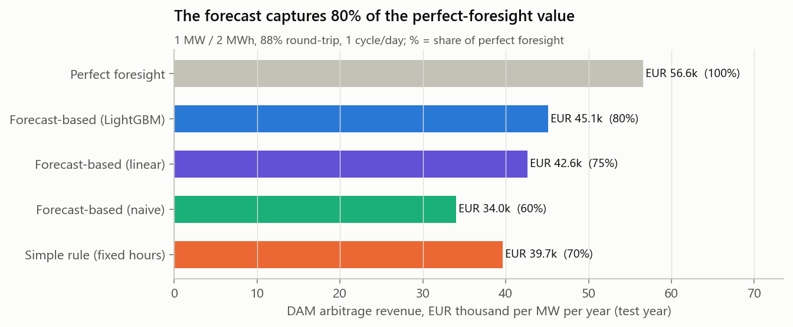
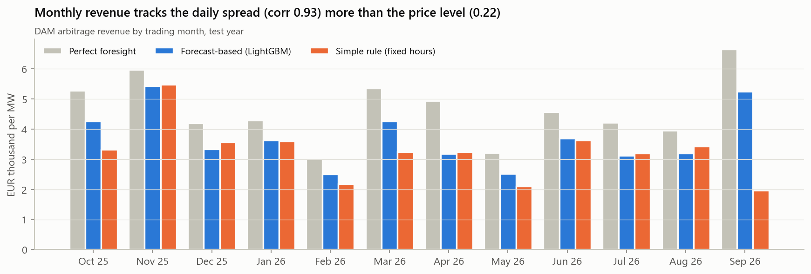
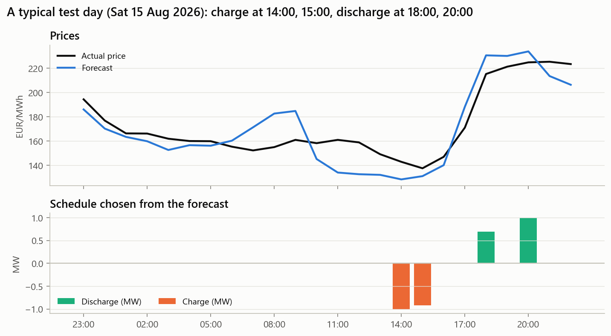
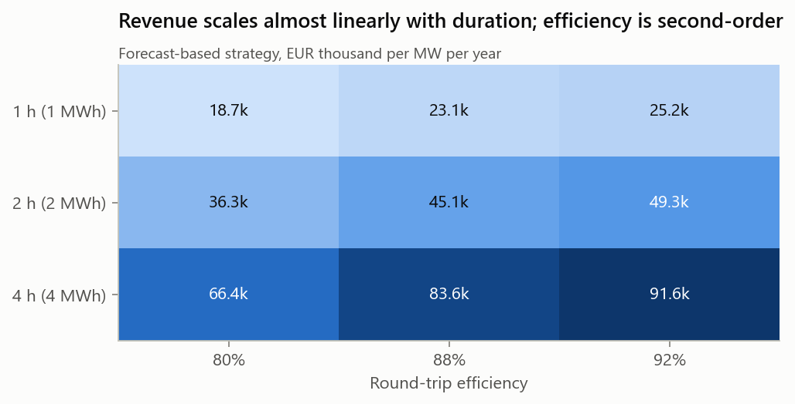

# Phase 4 - Battery arbitrage backtest (DAM only)

**Asset:** 1 MW / 2 MWh, 88% round-trip efficiency,
state of charge limited to 5%-95%, at most one full cycle per
trading day, trading the day-ahead market only. **Test year:** trading days Oct 2025 to Sep 2026,
of which 359 are scored. Six days are excluded because an input lag is missing:
1, 2 and 7 Oct 2025 follow a NULL Ember flat day, and 30-31 Mar and 5 Apr 2026 follow the
23-hour DST day. The same day set is used in every run.
Annual figures = mean daily revenue x 365.
The optimisation is formulated in the README; code is in `src/battery.py` and
`src/phase4_backtest.py`.

## Strategies

1. **Perfect foresight.** Optimise on actual prices. This is an upper bound, not an
   achievable result.
2. **Forecast-based.** At gate closure, optimise the schedule on the Phase 3 forecast, then
   settle every MWh at the actual DAM price. The linear and naive forecasts are shown for
   comparison.
3. **Simple rule.** No forecast at all: charge in the 2 cheapest and discharge in the 2 most
   expensive hours of the Year-1 average daily profile, set per season (winter: charge
   [3, 4], discharge [17, 18]; summer: charge
   [14, 15], discharge [19, 20]). The hours were fixed from
   Year 1, so the rule uses no test-year information.

## Results

| Strategy | Revenue per MW per year | Share of perfect foresight | Days with negative revenue |
|---|---|---|---|
| 1. Perfect foresight (upper bound) | EUR 56.6k | 100% | 0 |
| 2. Forecast-based, LightGBM | EUR 45.1k | 80% | 9 |
| 2b. Forecast-based, linear | EUR 42.6k | 75% | 15 |
| 2c. Forecast-based, naive (yesterday) | EUR 34.0k | 60% | 41 |
| 3. Simple rule (fixed hours) | EUR 39.7k | 70% | 12 |

- **The forecast-based strategy earns EUR 45.1k/MW/year,
  80% of the perfect-foresight value.** On a typical day it captures
  87% (median).
- **Value of forecasting.** Strategy 2 minus strategy 3 is
  **EUR 5.5k/MW/year**, about
  14% more revenue than the rule.
  Against a naive "yesterday's prices" forecast, the ML forecast is worth
  EUR 11.2k/MW/year.
- **Counter-intuitive result: a bad forecast is worse than no forecast.** The naive strategy,
  which optimises on yesterday's prices, earns *less* than the fixed rule
  (60% vs 70%). It also loses money on
  41 days. Yesterday's peak is often in the wrong hour today, while a
  fixed seasonal schedule at least averages over many days.
- **Revenue is concentrated.** Under perfect foresight, the best 10% of days earn
  22% of the annual total. Volatile, low-wind days are where a
  battery earns its money.
- **Year 1 comparison.** Perfect-foresight revenue in Year 1 was
  EUR 59.7k/MW, so the opportunity was similar in both years.

### Monthly

Monthly revenue tracks the average daily spread (correlation
0.93) much more than the price level
(0.22). The strongest month under perfect foresight is 2026-09
(EUR 6.7k), and the weakest is 2026-02 (EUR 3.0k).
In September 2026 the fixed rule earned only EUR 2.0k, against
EUR 5.3k for the forecast. When the daily price shape shifts
away from last year's pattern, a fixed schedule breaks down. That is exactly when a forecast
pays for itself.

## Sensitivity

Forecast-based strategy, revenue per MW per year (share of perfect foresight in brackets):

| Duration | 80% RTE | 88% RTE | 92% RTE |
|---|---|---|---|
| 1 h | EUR 18.7k (74%) | EUR 23.1k (78%) | EUR 25.2k (79%) |
| 2 h | EUR 36.3k (76%) | EUR 45.1k (80%) | EUR 49.3k (81%) |
| 4 h | EUR 66.4k (78%) | EUR 83.6k (82%) | EUR 91.6k (84%) |

- **Revenue rises almost linearly with duration** at 1 cycle per day. Per MWh of storage it
  slips only slightly: EUR 23.1k, EUR 22.6k and EUR 20.9k per MWh for 1, 2
  and 4 h at 88%. So whether a longer battery is worth building depends mainly on the capex
  per MWh, not on the market.
- **Efficiency is second-order but not negligible.** Moving from 80% to 92% adds about
  36% for a 2 h battery.
- **The forecast's capture rate improves with duration** (78% at 1 h,
  82% at 4 h). A longer battery needs the broad shape of the day
  right, not the exact peak hour, and that is easier to forecast.
- **The fixed rule is a 2-hour rule by definition.** For a 4 h battery it uses only part of the
  capacity (41% capture), so do not read it as a 4 h benchmark.
- **Half-hourly settlement.** The DAM actually clears in 30-minute periods. Re-optimising on
  the official half-hourly SEMOpx prices (337 test days with full data) raises
  perfect-foresight revenue by only **0.5%**, so the hourly simplification costs
  very little for a 2 h battery.

## Limitations (read before quoting any number)

- **DAM only.** No intraday (IDA/IDC), balancing market, capacity market or DS3 system-services
  revenue. In practice, system services and capacity payments are a large part of an Irish
  battery's income, so **these numbers are not total asset revenue**.
- **No degradation cost.** Every cycle is treated as free, which overstates the value of
  marginal low-spread cycles. A cycling cost of a few EUR/MWh would remove some trades.
- **Price-taker.** The battery's own bids are assumed not to move prices. For 1 MW that is
  fine; for a large fleet it is not.
- **No network charges, imbalance exposure, availability losses or forecast-error hedging.**
  The schedule is assumed to be delivered exactly as cleared.
- **The hourly price is Ember's first-half-hour value** (DECISIONS.md D9). The half-hourly
  sensitivity shows this effect is small.
- **Daily optimisation with an empty battery at each trading-day boundary.** No energy is
  carried over 23:00, so a small amount of value at that boundary is lost.
